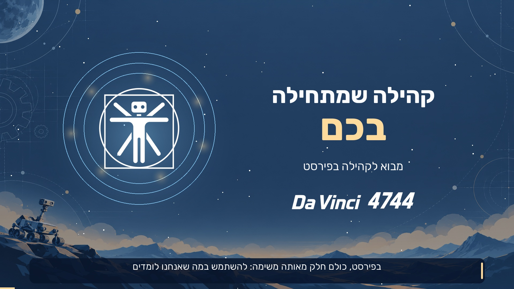

# Da Vinci · Presentations Creator

Create Hebrew presentations and explainer videos with Da Vinci 4744 branding. Open this repository in an assistant with local file access and describe what you want to create. The skills, backgrounds, logos, fonts, examples, and export tools are included.



## Start with a conversation

After cloning, open the repository's **root folder** as a local project in ChatGPT/Codex or Claude Code. For example:

> Create a 10-slide Hebrew presentation about recruiting sponsors for a FIRST team. The audience is a new team, and the training should take 20 minutes. Use the presentation skill and the branding in this repository, and export both PowerPoint and browser slides.

Or:

> Create an interactive Hebrew explainer video about our community activities, approximately two minutes long, with male and female Gemini narrators, music, animation, and two questions for the viewer. Use the video skill in this repository.

To explore immediately without installing anything, open the [browser presentation](examples/community/presentation.html), [PowerPoint example](examples/community/presentation.pptx), or [video with chapters and questions](examples/community/interactive/index.html). The included player links to the video elsewhere in the example folder; copy the entire example folder when sharing it.

The assistant reads `AGENTS.md` and the relevant skill. In Claude Code, you can also invoke `/davinci-presentation` or `/davinci-interactive-video`. See the [application guide](docs/apps.md) for app-specific instructions and limitations. A chat without local folder access needs uploaded files or a suitable coding environment; cloning the repository on your computer does not by itself give a chat access to it.

## Learning library website

An Expo website under `learning-library/` brings the presentations and interactive videos together in a responsive Hebrew library. It includes topic and format filters, chapter search, embedded viewing, shareable links, and PowerPoint downloads.

Run `npm ci` and `npm start` in `learning-library/`. `npm run build` exports the application to `learning-library/output/site/` without rendering local lessons or needing Python. GitHub Actions checks and deploys the application to [knowledge.davinci4744.com](https://knowledge.davinci4744.com/).

The gallery loads `library/catalog.json` from a dedicated Cloudflare R2 bucket. Published presentations, interactive players, videos and SCORM downloads live in R2; lesson publication is independent of application deployment. Prepare selected local lessons with `scripts/prepare_gallery.py --project <id>`, then publish and verify them with `scripts/publish_library.py`. See the [library guide](docs/gallery.md) and [R2 guide](docs/cloudflare.md).

The library is open for everyone to browse and use. Learning-platform integration uses SCORM exports.

For installation inside a learning platform, export a lesson as a self-contained **SCORM 1.2 ZIP**. Slides and interactive videos support a final knowledge check, scores, completion and progress saved in the LMS. See the [SCORM export guide](docs/scorm.md) and [pilot brief](projects/scorm-pilot/brief.md).

The [Cloudflare deployment guide](docs/cloudflare.md) covers Workers and GitHub Actions credentials. The retired `learn.davinci4744.com` hostname redirects public bookmarks to `knowledge.davinci4744.com`. The website uses Workers Static Assets; published learning content uses R2.

## First-time setup

Python 3.10 or newer is required. Installing dependencies requires an internet connection the first time. The tools are designed for macOS, Linux, and Windows; this repository was tested on macOS.

```sh
python3 scripts/setup.py
```

On Windows, run `py scripts/setup.py`. No global assistant settings need to change. After setup, use `.venv/bin/python`; on Windows, replace it with `.venv\Scripts\python.exe`.

Try the example presentation without an external account or API key:

```sh
.venv/bin/python -m davinci_creator deck examples/community/content.json --out outputs/community-deck
```

Open `outputs/community-deck/presentation.html`, or edit `presentation.pptx`. Install the included Rubik fonts on any other computer used to present the PowerPoint file. The [command guide](docs/commands.md) also covers creating projects, rendering videos, and running checks.

## What's included

- **Two skills** for creating presentations and interactive videos, with local copies for Codex and Claude Code.
- **Brand assets**: backgrounds, emblem, team name and number, wordmark, two Rubik font weights and their license, team and robot photos, and the visual reference document.
- **Presentations**: PowerPoint with editable text, self-contained HTML slides, speaker notes, and visual previews.
- **Videos**: Python animation and transitions, original music and sound effects generated in code, automatic music ducking during speech, Gemini narration using Kore and Puck, and Hebrew captions.
- **Interactive player**: chapters, transcript search, playback speed, locally saved progress, and questions with feedback. The MP4 provides continuous playback; the HTML player adds interactivity.
- **Ready-to-use example**: Introduction to Community in FIRST, including the approved video and its cached narration. You can build the example without sending a request to Gemini.
- **Team photo albums**: browse the three registered Google Photos albums, select photos visually, and import local images with source records for slides and videos. See the [photo album guide](docs/photos.md).

## Generate new narration

Only new narration requires a Gemini API key and access to a supported TTS model in your account. Set `GEMINI_API_KEY` in your environment, or pass `--key-file` with the path to a private file. Do not paste keys into chat or store them in the repository. `.env.example` documents variable names only; the tool does not automatically load `.env`.

```sh
.venv/bin/python -m davinci_creator tts projects/my-training/content.json
.venv/bin/python -m davinci_creator video projects/my-training/content.json --out projects/my-training/output/video
```

Narration is cached by transcript, voice, model, and delivery style. Changing any of these requires new narration. See the [official Gemini documentation](https://ai.google.dev/gemini-api/docs/speech-generation) for the speech engine and available models.

## Edit and share

Each project has a `brief.md` and `content.json` under `projects/`. Edit the content through your assistant or manually, then export again. The [content format](docs/content-format.md) and [brand guide](docs/brand.md) explain the available options.

To share a generated player, keep its entire `interactive/` folder together. Open `index.html`; if the browser restricts local captions or media, use the `serve` command in the command guide. Standalone players use no external service and send no viewing data. SCORM packages save progress and report results through the learning platform hosting the package.

Generated working outputs, gallery media, virtual environments, and API keys are excluded from Git. Published learning packages are uploaded to R2 and verified before their catalog entries become visible. [Asset sources and rights](assets/README.md) are documented alongside the files.
